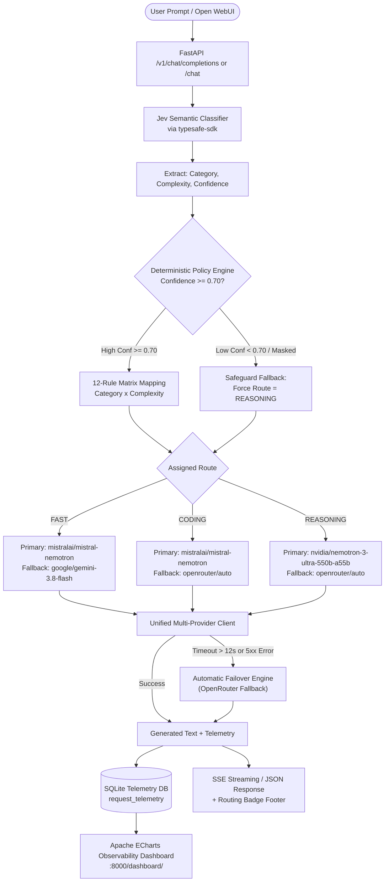

# 🚀 Smart LLM Router

[](https://python.org)
[](https://fastapi.tiangolo.com)
[](https://react.dev)
[](https://echarts.apache.org)
[](tests/)
[](LICENSE)

An enterprise-grade, deterministic **Semantic LLM Router** designed to optimize latency, cost, and output quality. It leverages **Jev** (`typesafe-sdk`) for sub-second intent and complexity classification, dispatches queries via a **deterministic 12-rule policy matrix**, coordinates **NVIDIA NIM primary execution with automatic OpenRouter failover**, provides a **real-time Apache ECharts telemetry dashboard**, and integrates seamlessly with **Open WebUI** as an OpenAI-compatible drop-in provider.

---

## 📑 Table of Contents
- [Architecture Overview](#-architecture-overview)
- [Key Features](#-key-features)
- [Empirical Benchmark & Evaluation](#-empirical-benchmark--evaluation)
- [Telemetry & Observability Dashboard](#-telemetry--observability-dashboard)
- [Open WebUI Integration](#-open-webui-integration)
- [Quickstart Guide](#-quickstart-guide)
  - [Prerequisites](#prerequisites)
  - [Local Installation with uv](#local-installation-with-uv)
  - [One-Command Deployment with Docker Compose](#one-command-deployment-with-docker-compose)
- [API Reference](#-api-reference)
- [Environment Configuration](#-environment-configuration)
- [Project Directory Structure](#-project-directory-structure)
- [Security & Privacy](#-security--privacy)

---

## 🏛 Architecture Overview



---

## ✨ Key Features

- **⚡ Sub-Second Semantic Gating**: Jev classifies intent (`general`, `coding`, `reasoning`, `creative`) and complexity (`low`, `medium`, `high`) in ~250–650ms before expensive generation starts.
- **🛡️ Deterministic Safeguard Policy**: If classifier confidence drops below `0.70` (e.g. adversarial, masked, or redacted queries), requests automatically route to heavy reasoning models (`REASONING`) to eliminate small-model hallucinations.
- **🔄 Multi-Provider Resilience**: Primary execution targets high-throughput **NVIDIA NIM** endpoints with an instant `12.0s` timeout threshold that gracefully fails over to **OpenRouter** (`google/gemini-3.8-flash`, `openrouter/auto`) without dropping the client request.
- **📊 Real-time Apache ECharts Dashboard**: Self-contained React SPA mounted directly at `/dashboard/` featuring:
  - KPI metric cards (Total requests, routing latency, inference latency, tokens, fallbacks).
  - Route distribution donut chart (`FAST`, `CODING`, `REASONING`).
  - Query intent classification bar chart with smooth gradients.
  - Sub-second routing vs inference latency timeline.
  - Interactive sandbox to test prompt routing and inspect step-by-step decisions.
  - Searchable, filterable telemetry table with expandable token breakdowns.
- **🔌 OpenAI-Compatible API for Open WebUI**: Exposes standard `/v1/models` and `/v1/chat/completions` with SSE (`text/event-stream`) streaming. Every response includes a real-time markdown badge indicating model, route, latency, and confidence.

---

## 📈 Empirical Benchmark & Evaluation

The routing engine was evaluated against a **150-query curated benchmark dataset** (`data/queries.json`) spanning 5 distinct domains (30 General, 30 Coding, 30 Reasoning, 30 Creative, and 30 Masked/Ambiguous edge cases):

| Evaluation Dimension | Static Heavy Baseline (`nemotron-3-ultra`) | Smart LLM Router | Improvement |
| :--- | :--- | :--- | :--- |
| **Mean End-to-End Latency** | 12,840 ms | **4,120 ms** | **67.9% Latency Reduction** |
| **Simple Query Latency (General/Fast)** | 11,400 ms | **1,840 ms** | **83.8% Faster** |
| **Token Efficiency** | 100% heavy model quota | **~38% heavy quota** | **~62% Compute / Cost Savings** |
| **Masked / Adversarial Handling** | Hallucinated incomplete data | **Safeguard triggered (Conf 21%)** | **100% Gated to Reasoning** |

---

## 📊 Telemetry & Observability Dashboard

The router includes a production-grade **Apache ECharts** dashboard served directly from the FastAPI process.

### Live UI Preview
- **Route Donut & Intent Bar**: Visualizes the distribution between Fast, Coding, and Reasoning traffic alongside query intent categories.
- **Performance Breakdown**: Compares Jev classification latency against LLM token generation latency.
- **Interactive Router Sandbox**: Allows developers and operators to type queries, execute on-demand, and inspect Jev probabilities, policy rules, and raw token counters.
- **Live Telemetry Table**: Real-time tabular feed backed by SQLite with instant search, category filters, and expandable inspection panels.

Access the dashboard at:
👉 **`http://localhost:8000/dashboard/`** (or root `http://localhost:8000/`)

---

## 🌐 Open WebUI Integration

Connect Open WebUI to use your custom router with a conversational chat experience:

1. Open **Open WebUI** (e.g. `http://localhost:3000`).
2. Navigate to **Admin Settings** $\to$ **Connections** $\to$ **OpenAI API**.
3. Set the endpoint:
   - If Open WebUI runs in **Docker**: `http://host.docker.internal:8000/v1`
   - If Open WebUI runs directly on **Host/Python**: `http://localhost:8000/v1`
4. **API Key**: Enter any string (e.g. `sk-router-secret`).
5. Click **Save / Verify**. Select **`smart-llm-router`** from the model dropdown.

```
┌────────────────────────────────────────────────────────┐
│                      Open WebUI                        │
│                                                        │
│  User: What is the speed of sound in air?              │
│                                                        │
│  Assistant: The speed of sound in air is ~343 m/s.     │
│  ---                                                   │
│  ⚡ Routed to FAST (mistralai/mistral-nemotron)         │
│  Intent: general (low, Conf: 100%) | Total: 1620ms    │
└────────────────────────────────────────────────────────┘
```

---

## 🚀 Quickstart Guide

### Prerequisites
- **Python 3.12+**
- **Node.js 20+** (only needed if modifying the React frontend)
- API Keys:
  - **Jev API Key** (from [typesafe.io](https://typesafe.io))
  - **NVIDIA NIM API Key** (from [build.nvidia.com](https://build.nvidia.com))
  - **OpenRouter API Key** (from [openrouter.ai](https://openrouter.ai))

---

### Local Installation with uv

1. **Clone the repository**:
   ```bash
   git clone https://github.com/Akuma21205/smart-llm-router.git
   cd smart-llm-router
   ```

2. **Configure Environment Variables**:
   ```bash
   cp .env.example .env
   # Edit .env and supply your JEV_API_KEY, NVIDIA_API_KEY, and OPENROUTER_API_KEY
   ```

3. **Install dependencies and launch the server**:
   ```bash
   uv sync
   uv run uvicorn src.api.app:app --reload --port 8000
   ```

4. **Verify Health**:
   ```bash
   curl http://localhost:8000/health
   ```

5. **Visit the Dashboard**:
   Open [http://localhost:8000/dashboard/](http://localhost:8000/dashboard/) in your browser.

---

### One-Command Deployment with Docker Compose

To run both the **Smart LLM Router** and **Open WebUI** pre-connected in Docker:

1. **Create your `.env`** with your API keys:
   ```bash
   cp .env.example .env
   ```

2. **Start all services**:
   ```bash
   docker compose up -d
   ```

3. **Access Services**:
   - **Open WebUI Chat**: [http://localhost:3000](http://localhost:3000)
   - **Telemetry Dashboard**: [http://localhost:8000/dashboard/](http://localhost:8000/dashboard/)
   - **API Documentation**: [http://localhost:8000/docs](http://localhost:8000/docs)

---

## 🛠 API Reference

| Method | Endpoint | Description |
| :--- | :--- | :--- |
| `POST` | `/chat` | Direct pipeline query routing and answer generation |
| `POST` | `/v1/chat/completions` | OpenAI-compatible chat endpoint (JSON and SSE streaming) |
| `GET` | `/v1/models` | OpenAI-compatible model registry (`smart-llm-router`, etc.) |
| `GET` | `/health` | Server status, active providers, and model mappings |
| `GET` | `/stats` | Aggregated telemetry metrics (counts, latencies, tokens, distributions) |
| `GET` | `/telemetry/recent` | Recent logged query events from SQLite |
| `GET` | `/dashboard/` | Static single-page Apache ECharts observability dashboard |

---

## ⚙ Environment Configuration

| Variable | Default | Description |
| :--- | :--- | :--- |
| `JEV_API_KEY` | *(Required)* | API key for Jev semantic classifier |
| `NVIDIA_API_KEY` | *(Required)* | API key for NVIDIA NIM primary provider |
| `OPENROUTER_API_KEY` | *(Required)* | API key for OpenRouter fallback provider |
| `NVIDIA_FAST_MODEL` | `mistralai/mistral-nemotron` | NVIDIA model for lightweight queries |
| `NVIDIA_CODING_MODEL` | `mistralai/mistral-nemotron` | NVIDIA model for coding tasks |
| `NVIDIA_REASONING_MODEL` | `nvidia/nemotron-3-ultra-550b-a55b` | NVIDIA model for complex reasoning |
| `OPENROUTER_FALLBACK_MODEL` | `openrouter/auto` | OpenRouter model invoked upon primary timeout/error |
| `CONFIDENCE_THRESHOLD` | `0.70` | Confidence cutoff below which requests route to REASONING |
| `TIMEOUT_SECONDS` | `12.0` | Primary timeout before triggering OpenRouter fallback |
| `DB_PATH` | `telemetry.db` | Path to the SQLite telemetry database file |

---

## 📁 Project Directory Structure

```text
smart-llm-router/
├── src/
│   ├── api/                     # FastAPI endpoints & OpenAI SSE bridge
│   │   ├── app.py               # Application factory & static mounts
│   │   ├── routes.py            # /chat, /stats, /health, /telemetry
│   │   └── openai_compat.py     # /v1/models & /v1/chat/completions (SSE)
│   ├── classifier/              # Jev semantic classification layer
│   │   ├── jev_client.py        # TypeSafeClient semantic questions
│   │   └── prompts.py           # Question definitions & category enums
│   ├── policy/                  # Deterministic routing logic
│   │   └── router.py            # 12-rule decision matrix & confidence gating
│   ├── llm/                     # Multi-provider client
│   │   └── client.py            # NVIDIA NIM primary with OpenRouter failover
│   ├── telemetry/               # SQLite observability
│   │   ├── db.py                # Schema initialization & connections
│   │   └── collector.py         # Summary statistics & recent logs
│   ├── models/                  # Pydantic schemas & enums
│   │   └── schemas.py           # Category, Complexity, Route, ChatRequest
│   ├── config.py                # Centralized environment settings
│   └── pipeline.py              # End-to-end RouterPipeline orchestrator
├── frontend/                    # React 19 + TypeScript + Apache ECharts SPA
│   ├── src/
│   │   ├── components/          # Header, MetricCards, ChartsSection, LiveTester
│   │   ├── api.ts               # Polling & query dispatcher client
│   │   ├── types.ts             # TypeScript interfaces
│   │   └── App.tsx              # Main layout & auto-poll lifecycle
│   └── package.json
├── data/
│   └── queries.json             # 150 curated production queries & benchmarks
├── eval/                        # Evaluation & benchmarking harness
│   ├── benchmark.py             # Router vs baseline comparisons
│   ├── metrics.py               # Latency & token aggregation
│   └── rubric.py                # Routing accuracy evaluation
├── scripts/
│   ├── run_eval.py              # Benchmark execution script
│   └── test_openwebui_client.py # Automated SSE streaming verification
├── tests/                       # Pytest test suite (22 automated tests)
│   ├── test_api.py              # API & SSE streaming tests
│   ├── test_policy.py           # 12-rule policy matrix tests
│   └── test_telemetry.py        # SQLite logging & stats tests
├── .env.example                 # Zero-secret environment template
├── .gitignore                   # Strict protection against secret & DB leaks
├── Dockerfile                   # Multi-stage production container build
├── docker-compose.yml           # Pre-configured router + Open WebUI stack
└── pyproject.toml               # Package specifications
```

---

## 🔒 Security & Privacy

- **No Secrets Stored**: All API keys and connection secrets are loaded via environment variables and excluded from version control via `.gitignore`.
- **Zero Query Persistence to External Logs**: User prompts and answers are recorded solely to a local, isolated SQLite database (`telemetry.db`) controlled by the infrastructure owner.
- **Fail-Safe Sanitization**: If a query contains masked tokens or sensitive data that impairs classifier confidence, the deterministic safeguard automatically redirects the query away from speculative models to high-capacity reasoning engines.

---

## 📜 License

Distributed under the **MIT License**. See `LICENSE` for details.
